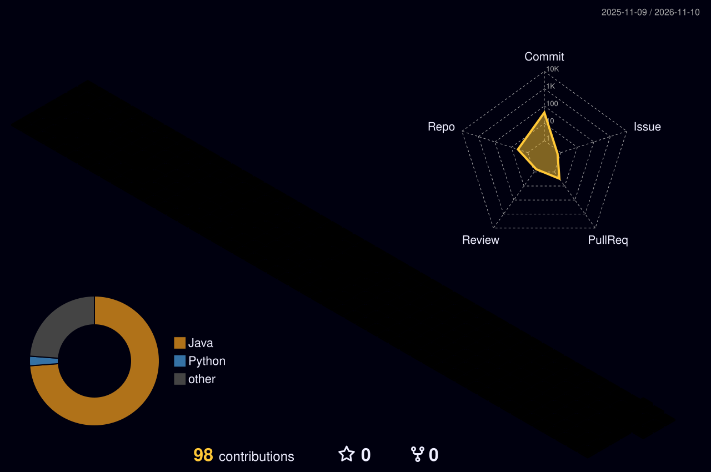

  

<b>🇬🇧 English version</b> (click to expand)

 

#### 🧑‍💻 About me

- 🎓 I'm studying **Multiplatform Application Development (DAM)** at **Prometeo by ThePower** (Madrid) · 2025 – 2027
- 🔧 I come from **electronics** (Higher Vocational Degree in electronic systems), so I like to understand how things work on the inside
- 🔐 My next step: a **Master's in Cybersecurity**
- 🧩 I enjoy **organised, consistent, detail-oriented** work, and working as part of a team
- 🌍 Spanish (native) · English (B2) · Japanese (basic, still learning 🇯🇵)

#### 🛠️ Tech stack

**Using:** Java · SQL · HTML & CSS · JavaScript · Spring Boot · Bootstrap · Django · Git & GitHub
**Learning:** Python · Kotlin · C++ · C#

#### 📂 Repositories

- [🦸 galeria-ovewatch](https://github.com/Colt246/galeria-ovewatch): Overwatch heroes gallery, my first-year final project (Spring Boot, PostgreSQL, Bootstrap)
- [🎓 DAM_entregas](https://github.com/Colt246/DAM_entregas): coursework from my first year of DAM
- [☕ programacion-entregas](https://github.com/Colt246/programacion-entregas): Programming exercises and practice (1st year)

#### 🎮 When I'm not coding…

Souls-likes (boss deaths: ∞ · times I gave up: 0) · Overwatch · anime & manga · comics and science books · drawing · padel 🎾

📬 Contact: [sergionavarrofernandez1@gmail.com](mailto:sergionavarrofernandez1@gmail.com)

---

### 🧑‍💻 Sobre mí

- 🎓 Estudio **DAM** en **Prometeo by ThePower** (Madrid) · 2025 – 2027
- 🔧 Vengo de la **electrónica** (FP Superior en sistemas electrónicos), así que me gusta entender cómo funcionan las cosas por dentro
- 🔐 Mi siguiente paso: un **máster en Ciberseguridad**
- 🧩 Me gusta el trabajo **ordenado, constante y con atención al detalle**, y trabajar en equipo
- 🌍 Español (nativo) · Inglés (B2) · Japonés (básico, aprendiendo 🇯🇵)

### 🛠️ Tecnologías

  
  
  
  
  
  
  
  
  
  

**Aprendiendo:**

  
  
  
  

### 📂 Mis repositorios

| Proyecto | Descripción |
|---|---|
| [🦸 galeria-ovewatch](https://github.com/Colt246/galeria-ovewatch) | Galería de héroes de Overwatch: proyecto final de 1º DAM con Spring Boot, PostgreSQL y Bootstrap |
| [🎓 DAM_entregas](https://github.com/Colt246/DAM_entregas) | Entregas de clase de 1º de DAM |
| [☕ programacion-entregas](https://github.com/Colt246/programacion-entregas) | Ejercicios y prácticas de Programación (1º DAM) |

### 🏙️ Mi ciudad de código

  

### 👾 Mi actividad

  

### 🎮 Cuando no estoy programando…

  

También: anime y manga · cómics y libros de ciencia · dibujar · pádel 🎾

---

  

